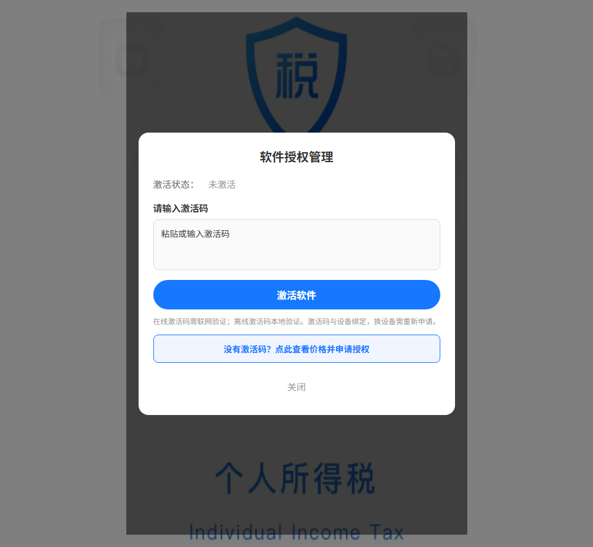
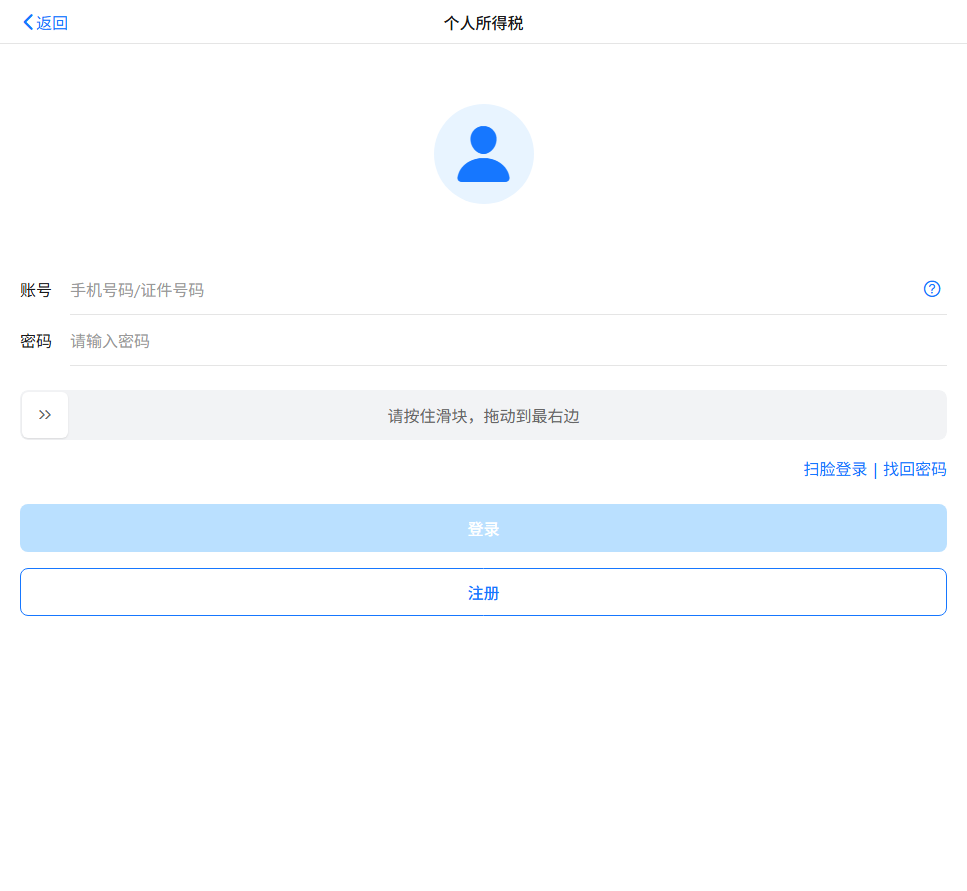
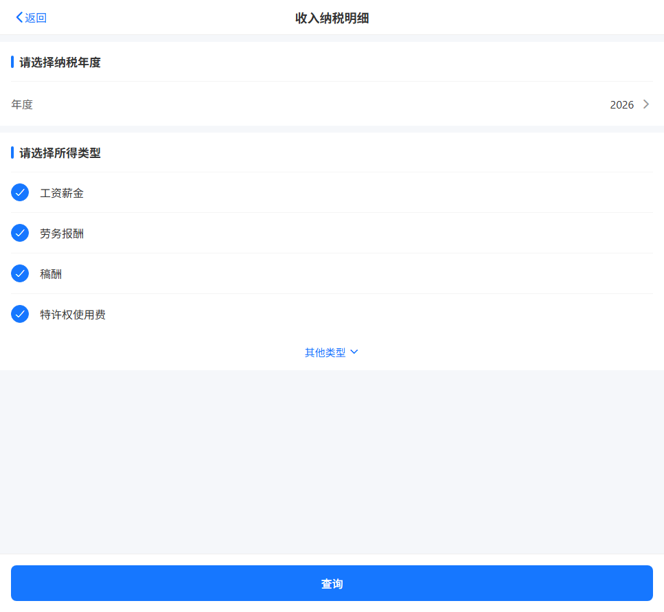
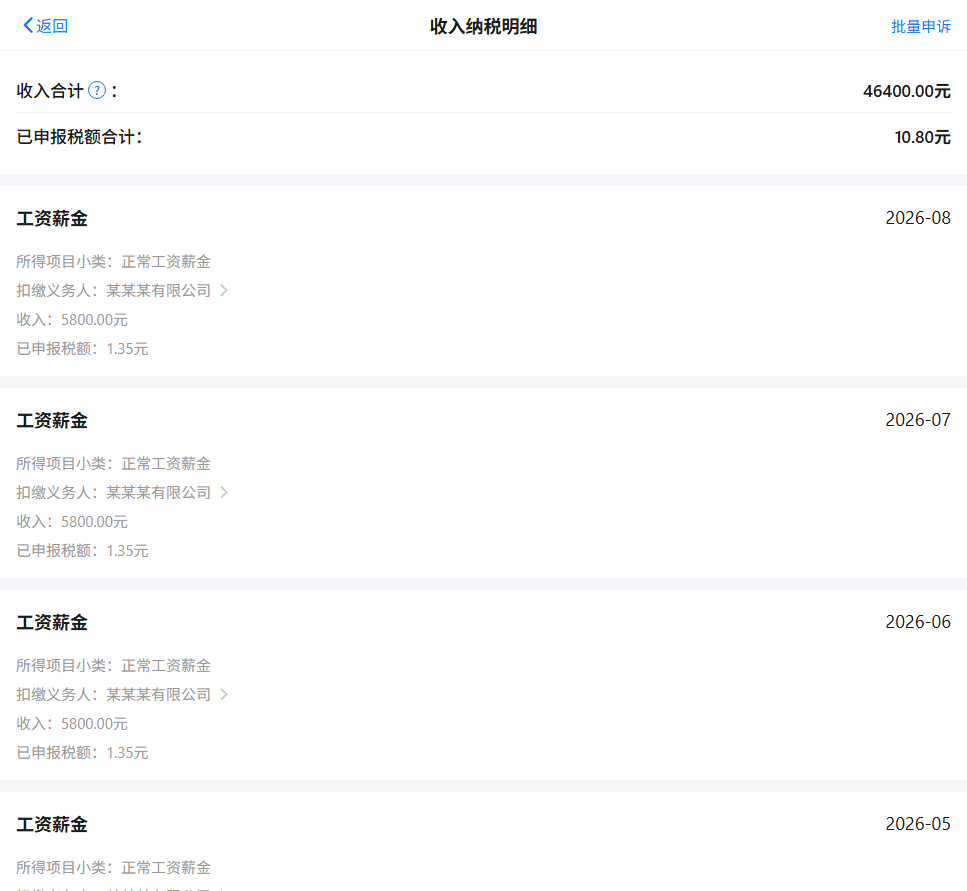
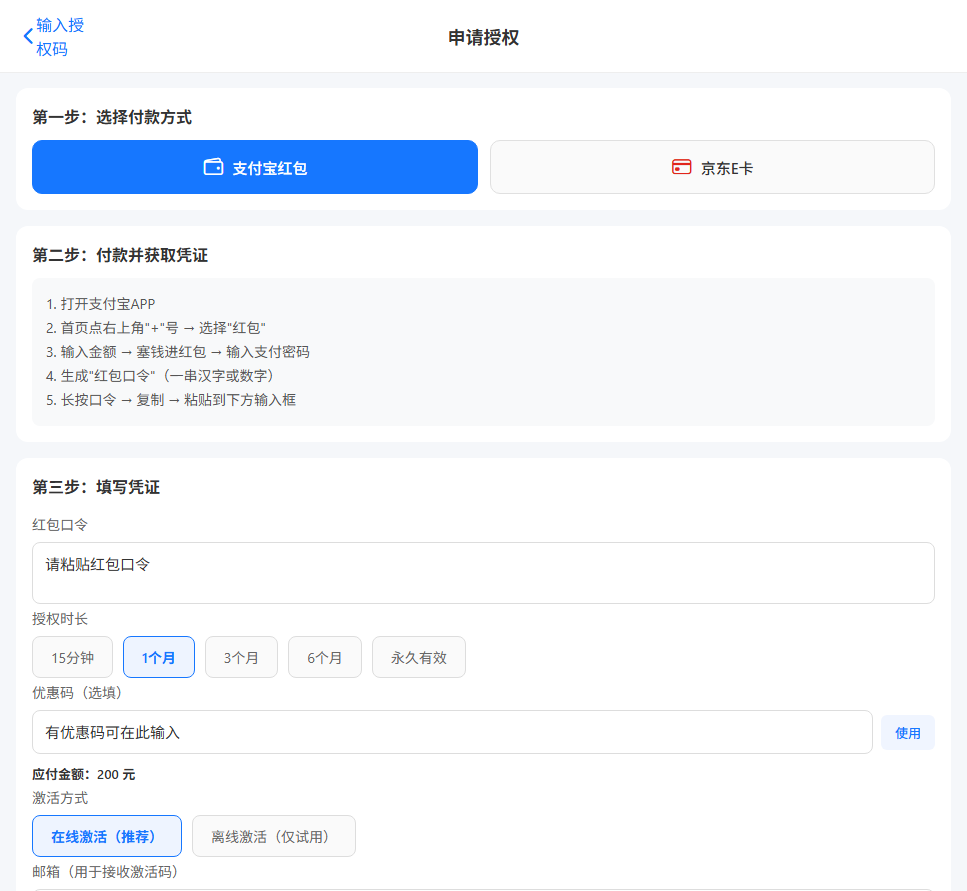
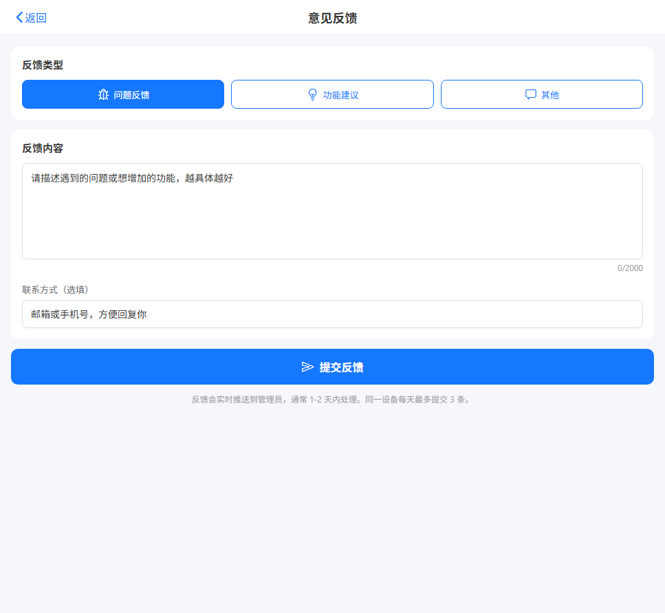
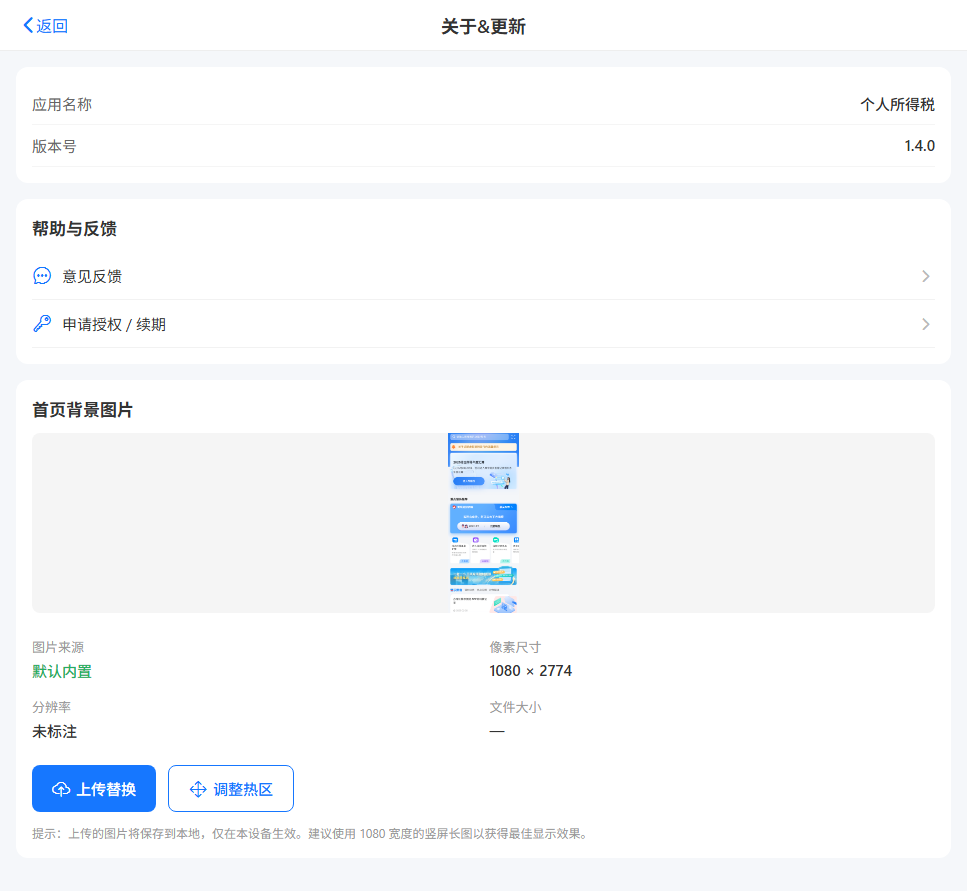

# 个人所得税 APP

高保真复刻的个税 APP 演示项目，基于 **Expo / React Native** 构建，支持本地离线运行。

**当前版本：v1.4.1**

## 📥 下载

**[⬇ 点击下载 Android APK v1.4.1 (111MB)](https://github.com/geshuiapp/geshui2026/releases/download/v1.4.1/geshui_v1.4.1.apk)**

> 下载后在手机上安装即可使用，无需联网服务器，所有数据存储在本地。

## 📖 使用说明书

**[📄 点击查看完整用户使用说明书](USER_GUIDE.md)**

内容包括：安装指南、激活流程、各页面操作说明、申请授权流程、常见问题与注意事项。

## 📝 更新日志

### v1.4.1
- 修复「关于 & 更新」页上传替换背景图失败的问题（Expo SDK 57 主入口已移除旧文件接口，改用 legacy 入口）
- 恢复图片信息显示：文件大小不再恒为 0，DPI 不再恒为 —
- 出错提示不再吞掉真实原因
- 新增启动免费试用：未激活且未领过的设备可领取固定时长试用，全程在线校验，断网立即暂停并超时跳转激活页（需在后台开启，默认关闭）
- 新增凭激活码自助迁移：换机或重装可用原激活码把授权迁移到新设备（迁移次数可在后台限制）

### v1.4.0
- 新增优惠码：申请页可填码并即时校验，金额按服务端套餐价二次计算，抵扣后红包码数量自动减少
- 新增免登录授权查询页：输入设备码即可查看到期时间、剩余天数、首次激活与续期次数
- 新增 App 内意见反馈：问题反馈 / 功能建议 / 其他，提交后可在管理后台查看与回复
- 新增收入看板：总收入、订单数、客单价，按套餐、支付方式、月份分组统计，支持导出 CSV
- 新增操作审计：解绑、改价、创建优惠码等管理动作留痕（含操作 IP，保留 90 天）
- 新增激活异常告警：同一激活码短时间内在多台设备尝试激活时自动推送提醒
- 新增界面偏好云同步：文字位置等偏好按设备码同步到云端，换机可恢复
- 我的页面新增「帮助与反馈」入口，版本号更新为 1.4.0

### v1.3.0
- 权限大幅精简：移除相册、录音、相机权限声明（Android 13+ 选图走系统 Photo Picker，无需权限）
- 降低杀毒软件误报概率（只剩 INTERNET 等系统必需权限）

### v1.2.0
- 支持多红包码输入：400元套餐2个红包、600元3个、800元4个
- 新增防刷限制：同设备每天5次申请上限、同IP每天20次
- PushPlus微信通知：新申请即时推送
- 管理后台优化：多凭证显示、手机端适配

## ✨ 功能亮点

- 🏠 **首页**：搜索栏、温馨提示、年度汇算专题入口，截图底图高清渲染，支持上传替换与热区调整
- 📋 **收入纳税明细**：年度选择（2019–2026）、所得类型筛选、按月收入/税额明细卡片，长按可修改/复制/删除
- 👤 **我的页面**：登录前后双态，姓名与纳税人识别号按原图位置/字号/间距还原
- 🔑 **激活码授权**：启动页 2 秒过渡，在线/离线双模式激活，绑定设备、到期自动失效
- 🛡 **安全防护**：未激活全局拦截、30 秒智能授权检查、时间回退检测

## 📸 页面截图

| 页面 | 截图 |
|------|------|
| 启动页 |  |
| 激活面板 |  |
| 首页 |  |
| 我的 · 登录后 |  |
| 我的 · 未登录 |  |
| 登录页 |  |
| 收入纳税明细 · 筛选 |  |
| 收入纳税明细 · 结果 |  |
| 申请授权 |  |
| 意见反馈 |  |
| 关于 & 更新 |  |

## 💰 价格

> 下表为参考价。实际价格以 App 内「申请授权」页面实时显示为准，可随时调整，以申请页为准。

| 时长 | 价格 |
|------|------|
| 试用 2 分钟 | 2 元 |
| 1 个月 | 200 元 |
| 3 个月 | 400 元 |
| 6 个月 | 600 元 |
| 永久有效 | 800 元 |
