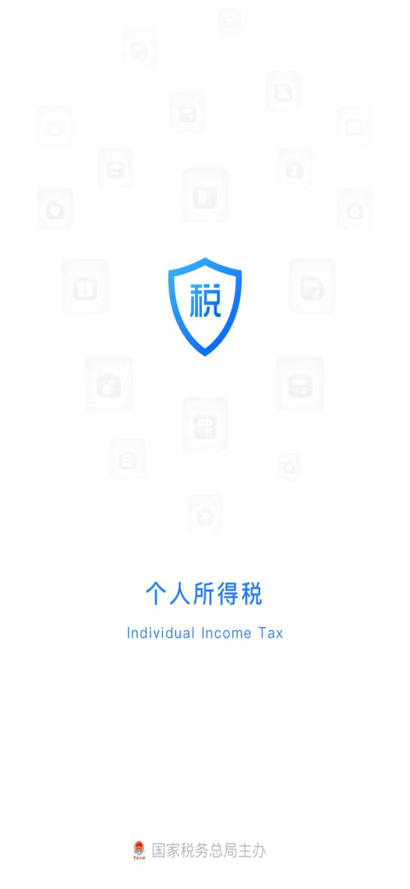
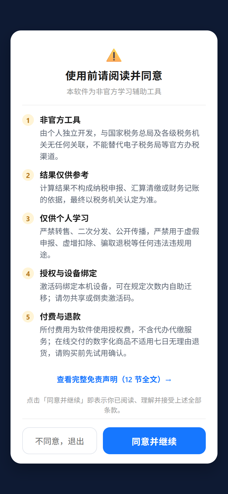
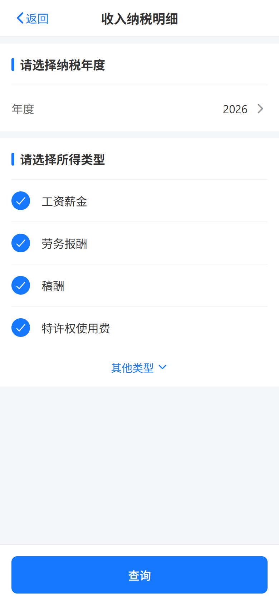
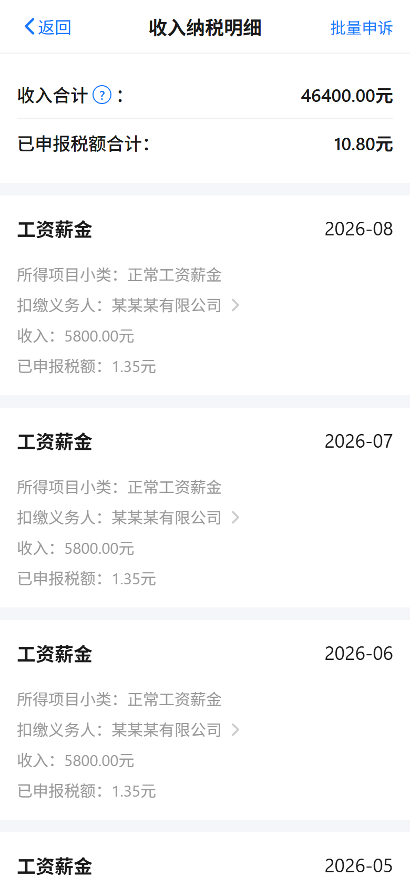
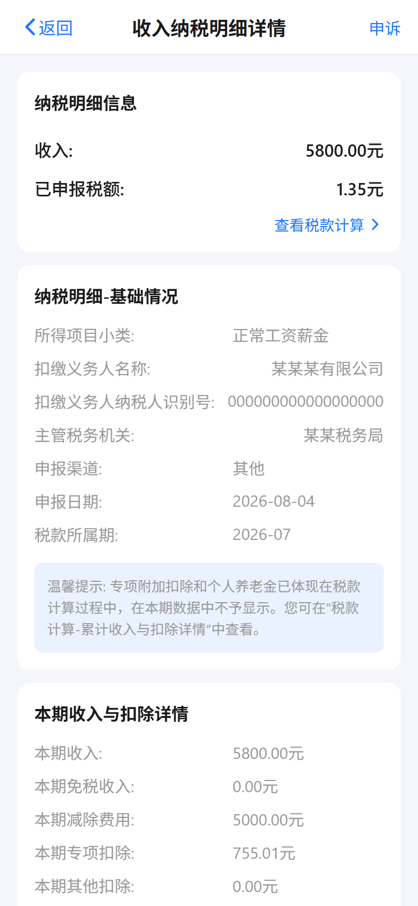
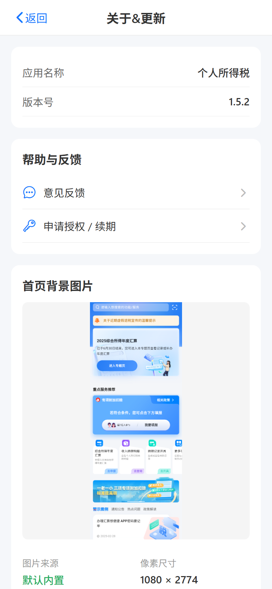
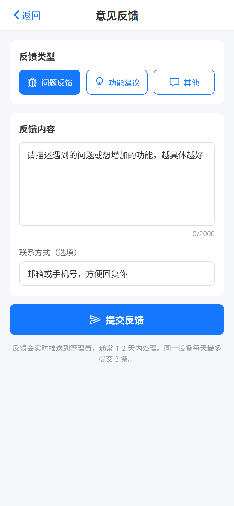

# 个人所得税 界面复刻

个税界面与功能复刻的学习演示项目，支持本地离线运行。

**当前版本：v1.5.3**

## 📥 下载

**[⬇ 点击下载 Android APK v1.5.3](https://github.com/geshuiapp/geshui2026/releases/download/v1.5.3/geshui_v1.5.3.apk)**

> 下载后在手机上安装即可使用，无需联网服务器，所有数据存储在本地。

> 仅提供当前版本，旧版本均已停止分发（Release 已转为草稿，旧下载链接返回 404）。

## 📖 使用说明书

**[📄 点击查看完整用户使用说明书](https://geshuiapp.github.io/geshui2026/guide.html)**

内容包括：安装、首次启动免责声明、免费试用、激活、设备码绑定、换机迁移、续期与解绑、各页面操作说明、申请授权、数据保存与清空规则、20 条常见问题。

## 📝 更新日志

### v1.5.3
- 新增「我的反馈」：意见反馈页右上角入口 + 列表页，可查看管理员回复，未读带红点
- 修复「修改报税记录」弹窗表单在安卓机上高度塌陷、看不到字段的问题，弹窗改为固定像素高度并可上下滑动
- 修复「关于 & 更新」上传自定义首页长图后被拉伸变形的问题，改为按原图宽高比渲染
- 隐私清理：移除含姓名、户籍、居住地等信息的整页截图，演示数据统一改为占位符

## ✨ 功能亮点

- 🏠 **首页**：搜索栏、温馨提示、年度汇算专题入口，截图底图高清渲染，支持上传替换与热区调整
- 📋 **收入纳税明细**：年度选择（2019–2026）、所得类型筛选、按月收入/税额明细卡片，长按可修改/复制/删除
- 👤 **我的页面**：登录前后双态，姓名与纳税人识别号按原图位置/字号/间距还原

## 📸 页面截图

| 页面 | 截图 |
|------|------|
| 启动页 |  |
| 免责声明 |  |
| 首页 |  |
| 我的 · 登录后 |  |
| 登录页 |  |
| 收入纳税明细 · 查询 |  |
| 收入纳税明细 · 结果 |  |
| 明细详情 |  |
| 申请授权 |  |
| 关于 & 更新 |  |
| 意见反馈 |  |

## ⚠️ 免责声明

本软件由个人独立开发，是面向个人所得税学习与日常估算的辅助工具，**与国家税务总局、各级税务机关、电子税务局及任何政府平台不存在隶属、合作、授权或认证关系**，不能替代官方办税渠道。

- **仅供学习**：仅供个人学习、研究与效率参考使用，不得用于代客申报、代理记账、税务咨询收费等经营性用途。
- **结果仅供参考**：计算依据为公开政策与你的输入，最终应纳税额、可扣除项目与优惠资格以税务机关认定为准；据此申报产生的申报差异、补税、滞纳金、罚款等后果由使用者自行承担。
- **禁止传播**：未经书面许可不得复制、转售、出租、二次分发或公开传播本软件及激活码，不得反向工程、破解或绕过授权校验，不得共享、倒卖或伪造激活码。
- **禁止非法用途**：不得用于伪造变造涉税资料、虚假申报、虚增扣除、骗取退税或税收优惠，以及洗钱、逃税、骗税等任何违法违规活动；一经发现将封禁授权并依法配合调查。
- **数据与隐私**：计算数据与设置默认保存在本机；仅授权校验、购买申请与售后所需的设备标识、激活码与联系方式会上传授权服务器。
- **付费与退款**：所付费用为软件使用授权费，不含代办代缴及税务服务；本软件为在线交付的数字化商品，依《消费者权益保护法》第二十五条不适用七日无理由退货，请购买前先试用确认。
- **责任限制**：软件按"现状"提供，不承诺无错误或不中断；在法律允许范围内不承担间接损失，但不排除依法不得排除的责任。

完整条款（12 节全文）：**https://geshuiapp.github.io/geshui2026/disclaimer.html**

联系方式：531707@gmail.com

